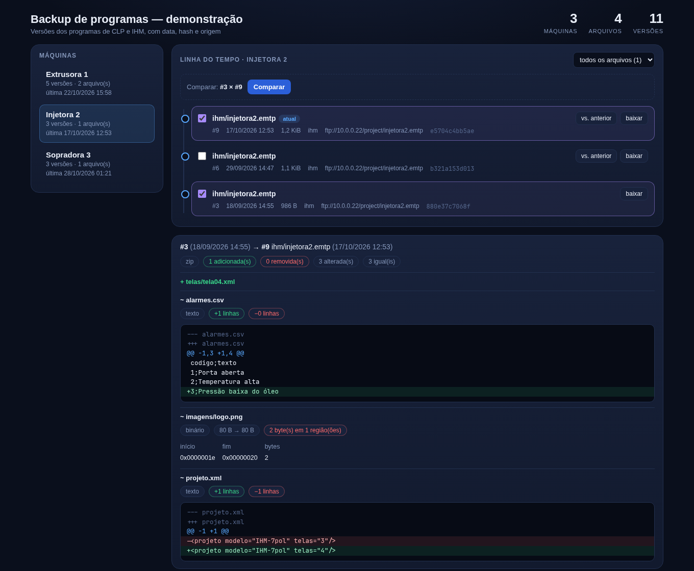

# backup-clp


**Versionamento automático dos programas de CLP e IHM.** Vigia as pastas onde os técnicos salvam os projetos das máquinas (WEG, Weintek EasyBuilder, Delta ISPSoft/DOPSoft, Siemens, `.V6F` e afins) e, se quiser, busca o projeto direto da IHM por FTP ou HTTP. Cada versão nova é guardada com data, hash SHA-256, autor e origem. Uma página web mostra a linha do tempo de cada máquina, baixa qualquer versão e mostra **o que mudou** entre duas.

O problema é conhecido de quem trabalha em fábrica: ninguém sabe ao certo qual programa está rodando na máquina, qual era o anterior nem quem mexeu. O backup existe, mas fica como `projeto_final_NOVO_2(3).wps` num pendrive.

Só Python e biblioteca padrão. Não precisa de git, banco externo nem framework web. Funciona em Linux e Windows, inclusive com pastas de rede (`\\servidor\pasta`).



## Uso rápido

Sem máquina nenhuma, com um acervo de demonstração (três máquinas e versões em texto, ZIP e binário):

```bash
python -m backup_clp demo        # → http://127.0.0.1:8899
```

Com a sua fábrica:

```bash
python -m backup_clp -c backup-clp.toml verificar      # mostra o que foi entendido da configuração
python -m backup_clp -c backup-clp.toml vigiar         # vigia as pastas/IHMs e sobe a página
python -m backup_clp versoes "Injetora 2"              # versões de uma máquina
python -m backup_clp diff 6 9                          # o que mudou da versão 6 para a 9
python -m backup_clp diff 9                            # a 9 contra a anterior do mesmo arquivo
python -m backup_clp restaurar 6 C:/Projetos/          # grava a versão 6 de volta
```

Sem `-c`, a configuração é `backup-clp.toml` na pasta atual (ou a variável `BACKUP_CLP_CONFIG`). Também dá para instalar com `pip install .` e usar o comando `backup-clp`.

## Como funciona

**Vigilância por varredura.** A cada `intervalo` segundos as pastas são varridas. Mudança de `mtime` ou tamanho marca o arquivo para conferência, e o hash decide se é versão nova. Salvar de novo sem mudar nada não gera versão. Varredura em vez de notificação do sistema porque em pasta de rede, sobretudo SMB, a notificação falha sem avisar.

**Arquivo estável.** Os softwares de programação gravam projetos grandes aos poucos, e numa pasta de rede isso leva segundos. O arquivo só é copiado depois de ficar `espera_estavel` segundos com o mesmo `mtime` e tamanho, e é conferido de novo depois da leitura: se mudou enquanto era lido, fica para a próxima volta. Arquivo que se viu mudar é cronometrado pelo relógio local, então cópia que preserva o `mtime` antigo e relógio adiantado do servidor de arquivos não enganam a espera.

**Armazenamento por conteúdo.** Cada conteúdo é gravado uma vez, em `acervo/objetos/ab/cdef…`, com o SHA-256 como nome e escrita atômica. O índice das versões (máquina, arquivo, hash, tamanho, data de modificação, data de captura, autor, origem) fica em `acervo/indice.db`, um SQLite. O mesmo programa copiado para duas máquinas ocupa espaço uma vez só. Ao ler, o hash é conferido: conteúdo corrompido no disco é recusado em vez de restaurado.

**Autor e origem.** No Linux o autor é o dono do arquivo. No Windows e no FTP vale o `autor` da máquina na configuração. A origem registra o computador e o caminho completo, ou a URL `ftp://` / `http://`.

**Retenção.** `versoes` mantém as N mais novas de cada arquivo, e `dias` apaga as mais velhas que isso. A versão mais nova de cada arquivo nunca é apagada. Conteúdos que ficaram sem versão saem do disco.

## O que mudou

| Conteúdo | O que mostra |
|---|---|
| texto, XML, CSV (UTF-8, UTF-16 com BOM ou Latin-1) | diff unificado, com linhas adicionadas e removidas |
| ZIP (vários formatos de projeto são ZIP por dentro) | entradas adicionadas, removidas e alteradas, com diff das que forem texto e regiões das binárias |
| binário | tamanho antes e depois, hash e as regiões alteradas em offsets (`0x00001388–0x00001392`), juntando as próximas |

```text
$ python -m backup_clp diff 3 9
#3 ihm/injetora2.emtp (2026-09-18T14:55:00)  ->  #9 ihm/injetora2.emtp (2026-10-17T12:53:00)
zip: 1 adicionada(s), 0 removida(s), 3 alterada(s), 3 igual(is)
  + telas/tela04.xml
  ~ alarmes.csv
    texto: +1 / -0 linhas
    --- alarmes.csv
    +++ alarmes.csv
    @@ -1,3 +1,4 @@
     codigo;texto
     1;Porta aberta
     2;Temperatura alta
    +3;Pressão baixa do óleo
  ~ imagens/logo.png
    binário: 80 B -> 80 B, 2 byte(s) em 1 região(ões)
      sha256 30f2ca196f0d6cee -> 0a743efb866fccce
      0x0000001e–0x00000020  (2 B)
  ~ projeto.xml
    texto: +1 / -1 linhas
    --- projeto.xml
    +++ projeto.xml
    @@ -1 +1 @@
    -<projeto modelo="IHM-7pol" telas="3"/>
    +<projeto modelo="IHM-7pol" telas="4"/>
```

## Configuração

```toml
titulo = "Fábrica — programas das máquinas"
acervo = "acervo"           # relativo a este arquivo
intervalo = 60              # segundos entre varreduras
espera_estavel = 15         # segundos parado antes de copiar

[retencao]
versoes = 200               # por arquivo (0 = todas)
dias = 0                    # 0 = nunca apaga por idade

[[maquina]]
nome = "Extrusora 1"
pastas = ["//srv-arquivos/clp/extrusora1", "C:/Projetos/Extrusora1"]
padroes = ["*.wps", "*.V6F", "*.xml", "*.csv"]
ignorar = ["~*", "*.bak", "*.tmp"]
autor = "engenharia"

[[maquina]]
nome = "Injetora 2"
pastas = ["//srv-arquivos/clp/injetora2"]
padroes = ["*.emtp", "*.cmtp", "*.isp", "*.dpa"]

[maquina.ftp]               # a IHM expõe o projeto por FTP
host = "10.0.0.22"
usuario = "backup"
senha_env = "SENHA_IHM_INJETORA2"
caminhos = ["/project/injetora2.cmtp", "/backup/"]    # terminado em "/" = pasta, filtrada pelos padrões
intervalo = 900
```

- `padroes` e `ignorar` não diferenciam maiúsculas. Sem `padroes`, vale uma lista de extensões comuns de CLP e IHM, mais `*.xml`, `*.csv` e `*.txt`.
- **Projeto que é uma pasta inteira.** O WEG WPS 2.60 não grava um `.wps`: o projeto é uma pasta (ladder em `.xdd`, blocos em `.xfb`/`.pfb`, configuração em `.xsc`/`.properties`, mais de 30 tipos e arquivos sem extensão). Aponte para `WPS 2.60 Configurations` com `padroes = ["*"]`. O `verificar` avisa quando uma pasta tem arquivos mas nenhum casa com os padrões.
- XML gravado numa linha só (como o do WPS 2.60) é quebrado entre as tags no "o que mudou", então uma troca de IP aparece como as duas linhas `<lIPAddress>` em vez de "a linha inteira mudou".
- Com mais de uma pasta na mesma máquina, o arquivo leva o nome da pasta na frente, para não misturar.
- `[maquina.http]` com `urls = [...]` faz o mesmo para CLPs e IHMs que entregam o backup por HTTP.
- Uma IHM desligada ou uma pasta de rede fora do ar não param o resto: o erro aparece no log e na página, e a coleta segue na próxima volta.

O exemplo completo está em [`exemplos/backup-clp.toml`](exemplos/backup-clp.toml).

## Página e linha de comando

| Comando | O que faz |
|---|---|
| `vigiar [--uma-vez] [--sem-painel]` | varre e coleta em laço, com a página web junto |
| `painel` | só a página, sem vigiar |
| `versoes MAQUINA [ARQUIVO] [--json]` | lista as versões |
| `diff A [B] [--json]` | o que mudou de A para B; só A compara com a anterior |
| `restaurar ID [DESTINO] [--forcar]` | grava a versão; não sobrescreve sem `--forcar` |
| `retencao [--versoes N] [--dias D]` | aplica a retenção agora |
| `exportar-git DESTINO` | exporta para um repositório git (opcional, precisa do `git`) |
| `verificar` | mostra a configuração entendida e quais pastas estão acessíveis |
| `demo` | página com um acervo de demonstração |

A página (`GET /`) é um HTML único sem framework. As rotas `GET /api/maquinas`, `/api/versoes?maquina=`, `/api/diff?a=&b=` e `/baixar/ID` devolvem JSON ou o arquivo. Para mandar a comparação para alguém, use um link direto: `/?maquina=Injetora%202&comparar=3,9`.

**Exportar para git.** Para quem já usa git, `exportar-git` cria um commit por versão, na ordem de captura, com a data e o autor originais. A exportação é incremental. O acervo continua sendo a fonte, e o git é só uma cópia para quem quiser `git log` e `git blame`.

## Testes

```bash
python -W error::ResourceWarning -m unittest discover -s tests -v
```

Cobrem a deduplicação por conteúdo, o arquivo instável que não é copiado (salvamento pela metade e cópia que preserva o `mtime`), salvar de novo sem mudança, diff de texto (UTF-8, UTF-16, Latin-1), diff de ZIP com entradas adicionadas, removidas e alteradas, regiões de binário, retenção por quantidade e por idade, coleta FTP contra um servidor FTP falso em thread (arquivo, pasta, intervalo, IHM desligada e senha errada), coleta HTTP, restauração (inclusive recusa de conteúdo corrompido), a página web de ponta a ponta, a exportação para git e a configuração de exemplo. Rodam no GitHub Actions com Python 3.11 a 3.13.

## Licença

MIT
